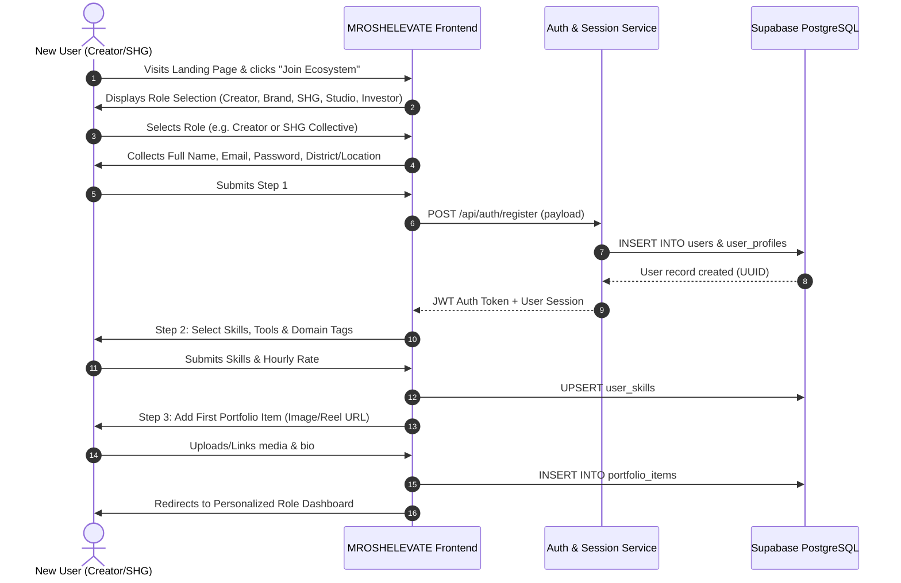
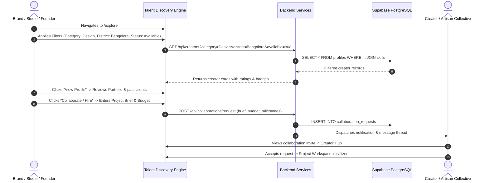
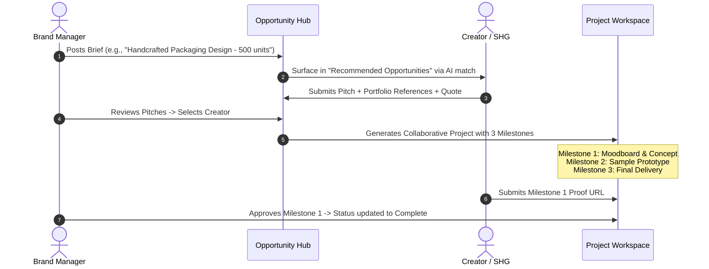

# MROSHELEVATE — Comprehensive Engineering & Product Blueprint
**"A Universe Where Talent Rises"**

**Role:** CTO, Senior Full-Stack Engineer, Product Architect & Lead UI/UX Designer  
**Document Version:** 1.0.0 (Production Master)  
**Target Pilot Scope:** Karnataka Pilot (100 Creators, 50 Self-Help Groups / Artisan Collectives, 10 Creative Studios)

---

## 1. PRODUCT ARCHITECTURE & SYSTEM TOPOLOGY

```
+-----------------------------------------------------------------------------------+
|                                 CLIENT CLIENT LAYER                               |
|   +---------------------------------------------------------------------------+   |
|   |   Design System Tokens (Dark Futuristic + Natural + Collaborative)         |   |
|   |   CSS Variables (#101214, #191D20, #202529, #B7D66A, #72B8A7, #F4F4F0)    |   |
|   +---------------------------------------------------------------------------+   |
|   | Public Website             | Authenticated Workspaces     | Shared Components |   |
|   | - Landing Page             | - Creator Hub (NumeHash)     | - Glass Cards     |   |
|   | - Explore Talent & SHGs    | - Brand Campaign Suite       | - Filter Pills    |   |
|   | - About & Ecosystem        | - Studio Booking (Collabify) | - Milestone Rails |   |
|   | - Opportunity Showcase     | - Investor/Grant (SafeGuard) | - Chat (Octom)    |   |
|   | - Role-Based Onboarding    | - Project Collaboration      | - Modals & Drawers|   |
+---+----------------------------+------------------------------+-------------------+---+
                                        | (HTTPS / REST / WebSocket)
                                        v
+-----------------------------------------------------------------------------------+
|                             APPLICATION & API LAYER                               |
|   +---------------------------------------------------------------------------+   |
|   |   API Gateway & Auth Middleware (JWT Token Verification, RBAC Guards)     |   |
|   +---------------------------------------------------------------------------+   |
|   | Auth Service       | Talent Discovery Engine   | Collaboration & Projects |   |
|   | - Multi-role signup| - Multi-faceted filter    | - Project workspace      |   |
|   | - Credential check | - District & craft query  | - Milestone verification |   |
|   | - Session state    | - Availability matcher    | - Deliverable repository |   |
|   +--------------------+---------------------------+--------------------------+   |
|   | Opportunity Hub    | Realtime Communication    | Verification & Trust     |   |
|   | - Gig/brand briefs | - Direct threads & media  | - Document verification  |   |
|   | - Pitch & proposal | - Project channels        | - Regional craft badges  |   |
+---+--------------------+---------------------------+--------------------------+---+
            |                                                   |
            v                                                   v
+-----------------------------+             +---------------------------------------+
|    AI INTELLIGENCE ENGINE   |             |           PERSISTENCE LAYER           |
| (Python 3.12 Microservice)  |             |      (PostgreSQL via Supabase)        |
| - Semantic skill-gap matrix |             | - Relational entities & constraints   |
| - Talent-to-Opportunity rank|             | - Row-Level Security (RLS) policies   |
| - Growth trajectory scoring |             | - Supabase Storage (Portfolios/Media) |
+-----------------------------+             +---------------------------------------+
```

### Strategic Architectural Principles
1. **Clean Separation of Concerns**: Complete decoupling of presentation layer, business service logic, and database layer.
2. **Progressive Enhancement**: MVP focuses on high-frequency, high-value workflows (Discovery, Profiles, Opportunities, Collaboration). Regulated equity investment and on-chain Web3 escrows are isolated behind service interfaces.
3. **Regional First-Class Citizens**: The architecture natively supports multi-member collectives (Self-Help Groups/SHGs) alongside individual creators and institutional studios.
4. **Performance & Lightweight Core**: Dark-first CSS token engine with zero runtime overhead, responsive flex/grid primitives, and optimized web font loading.

---

## 2. MVP FEATURE BREAKDOWN (KARNATAKA PILOT SCOPE)

### Target Pilot Demographics
- **100 Creators**: Visual designers, cinematographers, sound artists, UI/UX designers, 3D artists, and vernacular content creators (Bangalore, Mysore, Mangalore).
- **50 SHGs & Artisan Collectives**: Handloom weavers (Ilkal), wooden craft collectives (Channapatna), Bidriware artisans (Bidar), organic craft hubs.
- **10 Creative Studios**: Sound recording facilities, animation houses, and video production suites.

### Core Modules Matrix
| Module | MVP Pilot Scope (In Scope) | Future Expansion (Post-Pilot) |
| :--- | :--- | :--- |
| **Creator Feed (Core Blueprint)** | 3-Column Creator Feed: Central social & professional stream with Like, Comment, Share, Save, and rich composer. Left creator list & right connection recommendations. | Algorithmic personalized feed ranking & video reel streaming. |
| **Landing Page** | Visually immersive dark-futuristic landing page with ecosystem overview, live featured creators, opportunities, pilot highlights, and interactive CTAs. | Multilingual localization (Kannada, Hindi, Tamil). |
| **Authentication & Onboarding** | Multi-role registration (Creator, Brand, SHG, Studio, Investor), custom skill tags, location/district selector, portfolio quick-setup. | OAuth (Google/GitHub/LinkedIn) & DigiLocker ID verification. |
| **Profiles & Portfolios** | Rich profiles with bio, rate, skills, past clients, media showcase (images/video links), availability toggle, verification badge. | Dynamic video reel player with streaming compression. |
| **Talent Discovery** | Multi-attribute search and filtering (by Skill, Category, District, Availability, Rate, SHG collective status). | Vector-based semantic search & visual similarity. |
| **Collaboration & Workspace** | Project creation, collaborator invitations, deliverable checklist, milestone status tracker. | Real-time whiteboarding & integrated code/design previews. |
| **Opportunities Hub** | Posting gigs, briefs, and brand deals; creator applications with custom pitch and quote; applicant management. | Automated contract generation & Escrow payouts. |
| **Trust & Investment** | Transparent milestone-based project grant tracker (SafeGuard model) and verified creator badges. | SEBI-compliant revenue-sharing / creator equity marketplace. |
| **AI Intelligence** | Rule-based and embedding-powered talent-opportunity matching and growth suggestions. | Automated creator video feedback & AI script/asset generation. |

---

## 3. COMPLETE SCREEN INVENTORY

### A. Public-Facing Website (10 Screens)
1. **Landing Page (`/`)**:
   - Navigation: Sticky glass bar with logo, ecosystem links, and "Join Ecosystem" / "Explore Talent" actions.
   - Hero Section: "A Universe Where Talent Rises", ambient glowing backdrop, dual primary CTAs, dynamic creator floating cards.
   - Ecosystem Pillars: 4-quadrant interactive architecture (Discover, Collaborate, Fund, Grow).
   - Live Featured Talent: Carousel/Grid showcasing emerging designers, filmmakers, and Karnataka artisan collectives.
   - High-Impact Opportunities: Preview of live brand campaigns and creative gigs.
   - Pilot Impact Callout: Karnataka exploratory initiative (100 Creators, 50 SHGs, 10 Studios).
   - Testimonials / Success Stories: Authentic quotes and creator case studies.
   - Footer: Deep links, social handles, compliance notes, and newsletter.
2. **Explore Directory (`/explore`)**:
   - Advanced search bar, category pills, filter drawer (district, availability, skill, minimum rating).
   - Responsive card grid with 3D memoji / high-res avatars, verified tags, past clients, and action buttons.
3. **About (`/about`)**:
   - Startup manifesto, why MROSHELEVATE exists, bridging regional talent to national and global markets.
4. **How It Works (`/how-it-works`)**:
   - Interactive role-based tabbed journey for Creators, Brands, SHGs, and Studios.
5. **For Creators (`/creators`)**:
   - Deep dive into discovery algorithms, portfolio credibility, direct monetization, and peer collaboration.
6. **For Brands (`/brands`)**:
   - Talent sourcing without agency markups, regional craft integration for brand campaigns.
7. **For Investors & Supporters (`/investors`)**:
   - Creative project proposals, milestone visibility, backing next-gen creative IP.
8. **For Studios (`/studios`)**:
   - Equipment and studio capacity utilization, crew hiring, collaborative production briefs.
9. **Login (`/login`)**:
   - Modern glass card login with role selector, remember-me, and 1-click test personas for rapid pilot review.
10. **Role-Based Onboarding (`/signup`)**:
    - Multi-step interactive wizard: Step 1 (Select Role) -> Step 2 (Basic Info & Location) -> Step 3 (Skills & Domain) -> Step 4 (Portfolio & Links) -> Complete.

### B. Authenticated Workspaces
11. **Creator Dashboard (`/dashboard/creator`)**:
    - Inspired by NumeHash: Profile health score, active gigs, collaboration invites, audience metrics, earnings tracker.
12. **Brand Dashboard (`/dashboard/brand`)**:
    - Campaign pipeline, talent shortlists, incoming applications, milestone sign-offs.
13. **Studio Dashboard (`/dashboard/studio`)**:
    - Inspired by Collabify: Facility booking status, active crew roster, project milestones.
14. **Investor & Grant Tracker (`/dashboard/investor`)**:
    - Inspired by SafeGuard/Arbitrum: Funding progress bars, milestone deliverables, risk tags.
15. **Project Collaboration Hub (`/projects/:id`)**:
    - Deliverable rail, milestone progress bar, task assignments, shared asset drive.
16. **Opportunity Details & Application Modal (`/opportunities/:id`)**:
    - Detailed creative brief, deliverables, budget range, one-click pitch submission.
17. **Unified Messaging Channel (`/messages`)**:
    - Inspired by OCTOM: Threaded messages, project attachment previews, audio/video links.
18. **Settings & Verification (`/settings`)**:
    - Profile management, document uploads for verified badge, notification preferences.

---

## 4. USER FLOW DIAGRAMS

### Flow 1: Registration, Role Selection & Onboarding


### Flow 2: Talent Discovery & Collaboration Request


### Flow 3: Opportunity Posting, Pitch & Milestone Execution


---

## 5. DATABASE DESIGN (POSTGRESQL / SUPABASE DDL)

See complete, production-ready schema at `docs/schema.sql`.

Key entities included:
- `user_role` enum (`creator`, `brand`, `studio`, `investor`, `shg_collective`, `admin`)
- `users`: Core identity, email, authentication, verified badge status.
- `user_profiles`: Rich biographical, district/location, hourly rate, and portfolio headline.
- `skills` & `user_skills`: Normalized taxonomy of skills, tools, and craft disciplines.
- `portfolio_items`: Visual media assets, aspect ratio, tags, view counts, and engagement.
- `projects`: Collaborative containers for creator-brand-studio partnerships.
- `project_milestones`: Structured deliverable rails with due dates, amounts, and proof URLs.
- `opportunities`: Brand briefs, gig listings, and creative competition calls.
- `applications`: Pitches submitted to opportunities with rate quotes and status tracking.
- `collaboration_requests`: Direct hire/partner propositions between ecosystem entities.
- `messages`: Threaded communications supporting attachments and project references.
- `notifications`: Activity alerts for applications, invites, and milestone sign-offs.

---

## 6. FRONTEND COMPONENT ARCHITECTURE & DESIGN SYSTEM

### Visual Design Tokens (CSS Variables)
```css
:root {
  /* Color System */
  --bg-primary: #101214;        /* Deep obsidian space */
  --bg-secondary: #191D20;      /* Elevated surface */
  --bg-card: #202529;           /* Glass card background */
  --bg-card-hover: #272E33;     /* Interactive card hover */
  --bg-glass: rgba(32, 37, 41, 0.75);
  
  --accent-primary: #B7D66A;    /* Vivid nature-lime glow */
  --accent-primary-hover: #C5E579;
  --accent-primary-glow: rgba(183, 214, 106, 0.22);
  
  --accent-secondary: #72B8A7;  /* Balanced sage / teal */
  --accent-secondary-glow: rgba(114, 184, 167, 0.2);
  
  --text-primary: #F4F4F0;      /* Warm off-white */
  --text-secondary: #A0A6A4;    /* Neutral gray-green */
  --text-muted: #656C6A;        /* Dim placeholder text */
  
  --border-subtle: #303638;     /* Refined hairline border */
  --border-active: #4B5558;     /* Focused element border */
  --border-accent: rgba(183, 214, 106, 0.4);
  
  /* Elevation & Shadows */
  --shadow-card: 0 8px 32px rgba(0, 0, 0, 0.35);
  --shadow-glow: 0 0 24px rgba(183, 214, 106, 0.25);
  --shadow-glass: 0 4px 20px rgba(0, 0, 0, 0.4);
  
  /* Typography */
  --font-display: 'Plus Jakarta Sans', system-ui, -apple-system, sans-serif;
  --font-mono: 'JetBrains Mono', monospace;
  
  /* Radii */
  --radius-sm: 8px;
  --radius-md: 14px;
  --radius-lg: 20px;
  --radius-full: 9999px;
  
  /* Transitions */
  --transition-fast: 0.15s cubic-bezier(0.4, 0, 0.2, 1);
  --transition-smooth: 0.3s cubic-bezier(0.16, 1, 0.3, 1);
}
```

### Component Hierarchy
```
MROSHELEVATE UI Engine
├── Navigation
│   ├── MainNavbar (Glass floating pill, logo, links, auth controls, pilot badge)
│   ├── MobileDrawer (Touch-optimized slide-out menu)
│   └── DashboardSidebar (Icon + label responsive navigation with active states)
├── Cards & Media
│   ├── CreatorCard (Avatar, badge, skills, past clients, rating, action buttons)
│   ├── OpportunityCard (Company avatar, role tag, compensation, deadline)
│   ├── ProjectMilestoneRail (Horizontal/vertical progress with status icons)
│   ├── MetricStatCard (Trend indicator, primary counter, subtitle)
│   └── WaveformAudioPlayer (Interactive voice/sound snippet preview)
├── Form Controls & Filters
│   ├── SearchInput (With debounced auto-complete and keyboard shortcuts)
│   ├── FilterPillGroup (Multi-select category, district, and availability tags)
│   ├── DynamicRangeSlider (Budget and experience filter)
│   └── FileDropzone (Media upload preview with progress state)
└── Modals & Overlays
    ├── ProfileDetailsModal (Deep dive portfolio gallery and hire CTA)
    ├── QuickApplyModal (Opportunity pitch submission)
    ├── CollaborationModal (Custom brief & milestone offer creation)
    └── ToastManager (Accessible feedback notifications)
```

---

## 7. BACKEND ARCHITECTURE & REST SPECIFICATION

### Core REST API Endpoints
- **Authentication**:
  - `POST /api/auth/register` — Create account with role selection.
  - `POST /api/auth/login` — Authenticate and issue JWT session.
  - `GET  /api/auth/me` — Return authenticated user profile and roles.
- **Creators & Discovery**:
  - `GET  /api/creators` — Search and filter creators (`?category=&district=&skill=&available=`).
  - `GET  /api/creators/:id` — Full creator profile, portfolio items, and reviews.
  - `PUT  /api/creators/me` — Update personal profile, hourly rate, and availability.
- **Portfolios**:
  - `POST /api/portfolio/items` — Add new visual or media work item.
  - `DELETE /api/portfolio/items/:id` — Remove item.
- **Opportunities**:
  - `GET  /api/opportunities` — List active creative gigs and briefs.
  - `POST /api/opportunities` — Post new brief (Brands & Studios).
  - `POST /api/opportunities/:id/apply` — Submit pitch and quote.
- **Collaborations & Projects**:
  - `POST /api/collaborations` — Send direct collaboration proposal.
  - `GET  /api/projects/:id` — Fetch project workspace and milestone rail.
  - `PATCH /api/projects/:id/milestones/:mId` — Submit deliverable or approve milestone.
- **AI Matching Engine (Python Stub)**:
  - `GET  /api/ai/recommendations` — Fetch personalized opportunities for a creator.
  - `POST /api/ai/match-score` — Compute match affinity between creator profile and project brief.

---

## 8. PHASED DEVELOPMENT ROADMAP

```
Phase 1: Architecture & Design System (Done)
├── System topology definition
├── Supabase PostgreSQL DDL specification
├── Dark futuristic design tokens & UI library
└── Pilot scope lockdown (100 creators, 50 SHGs, 10 studios)

Phase 2: Visually Exceptional Landing Page & Public Screens (Current Turn)
├── Responsive sticky glass navigation with brand mark
├── High-impact Hero section with glowing ambient mesh and dynamic creator cards
├── 4-quadrant interactive ecosystem showcase
├── Filterable talent preview & live opportunity board preview
├── Karnataka pilot spotlight section
└── Interactive role modal & onboarding preview

Phase 3: Multi-Role Authentication & Onboarding
├── Role selection wizard (Creator, Brand, SHG, Studio, Investor)
├── Profile completion with skills taxonomy and district selector
└── Mock session engine with 1-click test personas for instant testing

Phase 4: Creator Profiles & Talent Discovery Engine
├── Interactive /explore directory with live search and filter pills
├── Full creator portfolio modal with media gallery and client badges
└── Direct collaboration trigger with milestone draft

Phase 5: Collaborative Project Workspace & Opportunities
├── Opportunity board with LuckyJob-inspired filters and quick-apply modal
└── Milestone progress rails with deliverable proof simulation (SafeGuard model)
```

