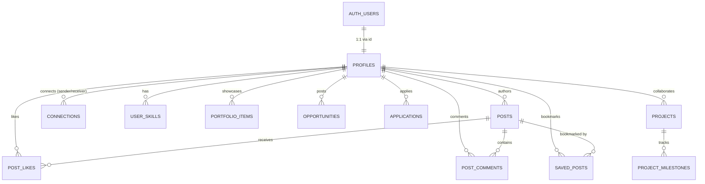

# MROSHELEVATE — SPRINT 2: BACKEND INTEGRATION AUDIT & SPECIFICATION
**"Transitioning from Frontend Prototype to Supabase-Backed Real Application"**

**Role:** CTO & Lead Full-Stack Architect  
**Document Version:** 2.0.0 (Pre-Implementation Audit)  
**Status:** Awaiting Executive Approval before Execution

---

## 1. COMPREHENSIVE CODEBASE & DATA AUDIT

### 1.1 Project File Structure & Inventory
```
MroshElevate/
├── .git/                                 # Git version history (clean working tree)
├── .gitignore                            # Environment & build ignores
├── docs/
│   ├── MROSHELEVATE_MASTER_BLUEPRINT.md  # Core product architecture & pilot scope
│   ├── SPRINT_2_BACKEND_INTEGRATION_PLAN.md # (This document)
│   └── schema.sql                        # Initial PostgreSQL DDL draft
└── public/
    ├── index.html                        # Master Single-Page Application (Feed, Network, Projects)
    ├── assets/
    │   └── references/                   # UI reference wireframes & pilot photos
    ├── css/
    │   ├── design-system.css             # Tokens, typography, buttons, glass cards
    │   ├── landing.css                   # Modals, pilot banners, tabs, filters
    │   └── feed.css                      # 3-column feed grid, composer, comments, cards
    └── js/
        ├── data.js                       # Mock talent & opportunities data
        ├── feed-data.js                  # Mock creator feed, connections & events data
        ├── app.js                        # Directory search, modals, onboarding wizard
        └── feed.js                       # Feed interactions (like, comment, post, share)
```

### 1.2 Data Source Audit: What Uses Mock Data?

| Module / Screen | Current Data Source | Current Mock Implementation | Target Supabase Entity |
| :--- | :--- | :--- | :--- |
| **Active User Session** | In-Memory (`FEED_DATA.currentUser`) | Hardcoded `"Alex Rivera"` (`avatar`, `role`). Reset on reload. | `auth.users` + `public.profiles` |
| **Creator Feed Posts** | In-Memory (`FEED_DATA.posts`) | 3 seeded posts (Sarah Chen, Marcus Rodriguez, Channapatna SHG). New posts added via composer exist only in client memory. | `public.posts` table |
| **Post Likes** | In-Memory (`post.isLiked`, `post.likes`) | Increments/decrements local object counter. Lost on reload. | `public.post_likes` table |
| **Post Comments** | In-Memory (`post.comments[]`) | Appends comment object to local array. Lost on reload. | `public.post_comments` table |
| **Post Bookmarks** | In-Memory (`post.isSaved`) | Toggles local boolean flag. Lost on reload. | `public.saved_posts` table |
| **Suggested Connections** | In-Memory (`FEED_DATA.suggestedConnections`) | 3 seeded users (Emma Thompson, David Park, Deepak Gowda). `[Connect]` button toggles local state. | `public.connections` table |
| **Upcoming Events** | In-Memory (`FEED_DATA.upcomingEvents`) | 3 static events. | `public.events` table |
| **Talent Directory** | In-Memory (`MROSH_DATA.creators`) | 6 hardcoded Karnataka pilot profiles (Kavya Murthy, Channapatna SHG, Rohan D'Souza, Ilkal Guild, Acoustic Bay, Deepak Gowda). | `public.profiles` + `public.user_skills` |
| **Portfolio Modals** | In-Memory (`creator.portfolio[]`) | Hardcoded static image URLs. | `public.portfolio_items` table |
| **Opportunities Board** | In-Memory (`MROSH_DATA.opportunities`) | 3 static briefs (Malnad Reserve, PixelCrafters, Kaveri Pictures). | `public.opportunities` table |
| **Opportunity Pitch Submission** | Fake submit handler in `app.js` | Shows toast message only; pitch data is discarded immediately. | `public.applications` table |
| **Milestone Tracker** | In-Memory (`MROSH_DATA.milestonesTracker`) | 3 static progress bars. | `public.project_milestones` table |
| **Collaboration Request** | Fake submit handler in `app.js` | Shows toast message only; proposal discarded immediately. | `public.collaboration_requests` table |
| **Onboarding Wizard** | Fake wizard in `app.js` | Steps 1-2 simulate role and district selection; no user created. | `supabase.auth.signUp()` + profile trigger |

### 1.3 Critical Gaps in Existing `schema.sql` vs. Implemented UI

A rigorous cross-comparison between `docs/schema.sql` and our live UI reveals **6 major table gaps**:

1. **MISSING `posts` Table**: The centerpiece 3-column feed is completely absent from `schema.sql`! We need a first-class `posts` table (`id`, `author_id`, `content`, `media_url`, `media_type`, `tags`, `created_at`).
2. **MISSING `post_likes` Table**: No table exists to track which user liked which post, preventing duplicate likes and enabling fast counts.
3. **MISSING `post_comments` Table**: No threaded or chronological comment storage.
4. **MISSING `saved_posts` / Bookmarks Table**: No table to persist saved posts.
5. **MISSING `connections` Table**: The "Suggested Connections" feature in the right sidebar has no table to store follow/connect requests and statuses (`pending`, `accepted`).
6. **MISSING `events` Table**: The "Upcoming Events" panel in the right sidebar has no database table.
7. **`users` vs `auth.users` Inconsistency**:
   - `schema.sql` defined an independent `public.users` table with a custom `password_hash VARCHAR(255)`.
   - **Flaw**: Supabase manages passwords securely inside the protected `auth.users` schema. Storing duplicate passwords in `public.users` is insecure, redundant, and breaks Supabase Auth.
   - **Correction**: `public.profiles` must link directly to `auth.users.id` with `ON DELETE CASCADE`.

---

## 2. BACKEND ARCHITECTURE EVALUATION

### 2.1 Supabase-Direct vs. Node.js/Express vs. Hybrid

| Evaluation Criteria | Option A: Supabase-Direct (PostgREST + RLS) | Option B: Node.js/Express + Supabase DB | Option C: Hybrid (Supabase Client + Python AI) |
| :--- | :--- | :--- | :--- |
| **Architecture Complexity** | **Low (Optimal)**: Zero server deployment; uses Supabase's auto-generated REST API. | **High**: Duplicate routing, duplicate controllers, server hosting, CORS configuration. | **Medium**: Supabase handles all web traffic; Python runs only for heavy background ML. |
| **Security Model** | **Enterprise**: Postgres Row-Level Security (RLS) guarantees data isolation at database kernel level. | **Vulnerable**: Security depends on developer correctly applying Express middleware on every route. | **Enterprise**: RLS protects all frontend operations. |
| **Realtime Capabilities** | **Native**: Supabase Realtime delivers WebSocket live updates for likes, comments, and messages out of the box. | **Complex**: Requires custom Socket.io server and pub/sub cluster. | **Native**: Realtime on all social interactions. |
| **Development Velocity** | **Fastest**: Startup team of six focuses 100% on product, workflows, and pilot validation. | **Slow**: 3x more code to write, test, and maintain. | **Fast**: Clean separation of core data vs. future AI services. |

### 2.2 Recommendation: Supabase-Direct Architecture for MVP
For Sprint 2 and the Karnataka pilot, **Supabase-Direct** is the recommended architecture:
- Use the official `@supabase/supabase-js` client in the frontend.
- Authenticate via `supabase.auth`.
- Enforce all authorization via PostgreSQL **Row Level Security (RLS)**.
- Handle media through **Supabase Storage**.
- Utilize **Supabase Realtime** for instant feed reactions.
- *Strict Rule*: Only the public `SUPABASE_ANON_KEY` is exposed in the client. The `SERVICE_ROLE_KEY` is never bundled in frontend code.

---

## 3. DATABASE VALIDATION & ENHANCED DDL SPECIFICATION

### 3.1 Entity Relationship Diagram (ERD)



### 3.2 Enhanced Schema Additions (To be executed via Supabase SQL Editor)

```sql
-- 1. Profiles Table linked directly to Supabase auth.users
CREATE TABLE IF NOT EXISTS public.profiles (
    id UUID PRIMARY KEY REFERENCES auth.users(id) ON DELETE CASCADE,
    email VARCHAR(255) NOT NULL,
    full_name VARCHAR(150) NOT NULL,
    role user_role NOT NULL DEFAULT 'creator',
    avatar_url TEXT,
    banner_url TEXT,
    headline VARCHAR(200),
    bio TEXT,
    hourly_rate VARCHAR(50),
    primary_category VARCHAR(100),
    district VARCHAR(100) DEFAULT 'Bangalore Urban',
    state VARCHAR(100) DEFAULT 'Karnataka',
    availability availability_status DEFAULT 'available',
    is_verified BOOLEAN DEFAULT FALSE,
    verification_badge VARCHAR(50),
    rating DECIMAL(3, 2) DEFAULT 5.0,
    reviews_count INT DEFAULT 0,
    created_at TIMESTAMP WITH TIME ZONE DEFAULT NOW(),
    updated_at TIMESTAMP WITH TIME ZONE DEFAULT NOW()
);

-- 2. Creator Feed Posts Table
CREATE TABLE IF NOT EXISTS public.posts (
    id UUID PRIMARY KEY DEFAULT uuid_generate_v4(),
    author_id UUID NOT NULL REFERENCES public.profiles(id) ON DELETE CASCADE,
    content TEXT NOT NULL,
    media_url TEXT,
    media_type VARCHAR(50), -- 'image', 'video', 'audio'
    tags TEXT[] DEFAULT ARRAY[]::TEXT[],
    likes_count INT DEFAULT 0,
    comments_count INT DEFAULT 0,
    shares_count INT DEFAULT 0,
    created_at TIMESTAMP WITH TIME ZONE DEFAULT NOW(),
    updated_at TIMESTAMP WITH TIME ZONE DEFAULT NOW()
);

-- 3. Post Likes (Unique Constraint prevents duplicate likes)
CREATE TABLE IF NOT EXISTS public.post_likes (
    post_id UUID NOT NULL REFERENCES public.posts(id) ON DELETE CASCADE,
    user_id UUID NOT NULL REFERENCES public.profiles(id) ON DELETE CASCADE,
    created_at TIMESTAMP WITH TIME ZONE DEFAULT NOW(),
    PRIMARY KEY (post_id, user_id)
);

-- 4. Post Comments
CREATE TABLE IF NOT EXISTS public.post_comments (
    id UUID PRIMARY KEY DEFAULT uuid_generate_v4(),
    post_id UUID NOT NULL REFERENCES public.posts(id) ON DELETE CASCADE,
    author_id UUID NOT NULL REFERENCES public.profiles(id) ON DELETE CASCADE,
    text TEXT NOT NULL,
    created_at TIMESTAMP WITH TIME ZONE DEFAULT NOW()
);

-- 5. Saved Posts / Bookmarks
CREATE TABLE IF NOT EXISTS public.saved_posts (
    user_id UUID NOT NULL REFERENCES public.profiles(id) ON DELETE CASCADE,
    post_id UUID NOT NULL REFERENCES public.posts(id) ON DELETE CASCADE,
    created_at TIMESTAMP WITH TIME ZONE DEFAULT NOW(),
    PRIMARY KEY (user_id, post_id)
);

-- 6. Connections (Follow/Connect Network)
CREATE TABLE IF NOT EXISTS public.connections (
    id UUID PRIMARY KEY DEFAULT uuid_generate_v4(),
    sender_id UUID NOT NULL REFERENCES public.profiles(id) ON DELETE CASCADE,
    receiver_id UUID NOT NULL REFERENCES public.profiles(id) ON DELETE CASCADE,
    status VARCHAR(50) DEFAULT 'accepted', -- 'pending', 'accepted', 'declined'
    created_at TIMESTAMP WITH TIME ZONE DEFAULT NOW(),
    UNIQUE(sender_id, receiver_id)
);

-- 7. Upcoming Events Table
CREATE TABLE IF NOT EXISTS public.events (
    id UUID PRIMARY KEY DEFAULT uuid_generate_v4(),
    title VARCHAR(200) NOT NULL,
    day VARCHAR(10) NOT NULL,
    month VARCHAR(10) NOT NULL,
    meta TEXT NOT NULL,
    event_type VARCHAR(50) DEFAULT 'virtual',
    created_at TIMESTAMP WITH TIME ZONE DEFAULT NOW()
);
```

---

## 4. AUTHENTICATION & ACCESS CONTROL (RBAC) PLAN

### 4.1 Multi-Role User Lifecycle
1. **User Sign Up (`supabase.auth.signUp`)**:
   ```javascript
   const { data, error } = await supabase.auth.signUp({
     email: form.email,
     password: form.password,
     options: {
       data: {
         full_name: form.fullName,
         role: form.role, // 'creator' | 'shg_collective' | 'brand' | 'studio' | 'investor'
         district: form.district
       }
     }
   });
   ```
2. **Automated Profile Provisioning (PostgreSQL Trigger)**:
   A native database trigger listens to `AFTER INSERT ON auth.users` and automatically creates a row in `public.profiles` using `new.raw_user_meta_data`, guaranteeing referential integrity with zero race conditions.
3. **Session Persistence**:
   `supabase.auth.onAuthStateChange((event, session) => ...)` keeps the client in sync. When authenticated, the top nav avatar reflects the real logged-in user, and the post composer binds to the active UUID.

### 4.2 Row-Level Security (RLS) Strategy

| Table | Read Policy (SELECT) | Write Policy (INSERT/UPDATE/DELETE) |
| :--- | :--- | :--- |
| `profiles` | Public read for all verified profiles. | `auth.uid() = id` (Users can only update their own profile). |
| `posts` | Public read for all posts. | Insert: `auth.uid() = author_id`. Update/Delete: `auth.uid() = author_id`. |
| `post_likes` | Public read. | Insert/Delete: `auth.uid() = user_id`. |
| `post_comments`| Public read. | Insert: `auth.uid() = author_id`. Delete: `auth.uid() = author_id`. |
| `saved_posts` | Only the user can view their own saves (`auth.uid() = user_id`). | `auth.uid() = user_id`. |
| `connections` | Public read. | Insert: `auth.uid() = sender_id`. Delete: `auth.uid() = sender_id`. |
| `opportunities`| Public read for open briefs. | Insert: Only `brand` or `studio` roles (`auth.uid() = poster_id`). |
| `applications` | Opportunity poster AND applicant can read. | Insert: Only `creator` or `shg_collective` roles (`auth.uid() = applicant_id`). |

---

## 5. SUPABASE STORAGE ARCHITECTURE

### 5.1 Storage Buckets Configuration
1. **`avatars`** (Public): User and collective profile pictures. Limit: 2MB. MIME: `image/png`, `image/jpeg`, `image/webp`.
2. **`covers`** (Public): Profile and studio banner images. Limit: 5MB. MIME: `image/png`, `image/jpeg`, `image/webp`.
3. **`portfolios`** (Public): Creator and collective visual works. Limit: 10MB. MIME: `image/*`, `application/pdf`.
4. **`post-media`** (Public): Images and audio waveforms attached to feed posts. Limit: 15MB. MIME: `image/*`, `audio/mpeg`, `audio/wav`.
5. **`deliverables`** (Restricted): Project milestone deliverables. Limit: 50MB. Access restricted to project members.

### 5.2 Storage Security Rules
- Files are saved with the user's UUID in the path: `${bucket}/${auth.uid()}/${filename}`.
- RLS Policy on `storage.objects`:
  - `SELECT`: Public for `avatars`, `covers`, `portfolios`, and `post-media`.
  - `INSERT`: Allowed only when `auth.uid()::text = (storage.foldername(name))[1]`.

---

## 6. SPRINT 2 INCREMENTAL IMPLEMENTATION ROADMAP

```
[Phase 1: Config & Environment] 
  └── Setup supabase client config (credentials prompt, env placeholder, CDN loader)

[Phase 2: Database Schema & Triggers]
  └── Apply enhanced DDL (Posts, Likes, Comments, Saves, Connections, Events)
  └── Create auth.users -> public.profiles trigger

[Phase 3: Supabase Client Adapter]
  └── Create public/js/supabase-client.js wrapper
  └── Graceful fallback: If keys not yet supplied, seamlessly fall back to local seed data

[Phase 4: Real Authentication Flow]
  └── Connect Onboarding Wizard Step 1 & 2 to supabase.auth.signUp()
  └── Connect Sign In modal to supabase.auth.signInWithPassword()
  └── Add Sign Out button in profile menu

[Phase 5: Real Creator Feed Persistence]
  └── Fetch live feed posts from public.posts via PostgREST
  └── Connect Post Composer to supabase.from('posts').insert()
  └── Implement real Like/Unlike toggle in public.post_likes
  └── Implement real Comment posting in public.post_comments

[Phase 6: Live Connections & Events]
  └── Fetch right sidebar connections from public.profiles
  └── Connect [Connect] button to public.connections

[Phase 7: Storage Integration]
  └── Add file input to Post Composer for image uploads to post-media bucket

[Phase 8: Directory & Projects Persistence]
  └── Fetch talent directory from public.profiles + skills
  └── Submit real pitches to public.applications
```

---

## 7. STRICT RULES & PRESERVATION CHECKLIST

- [x] **Zero UI Destruction**: All existing HTML structure, CSS layouts, and micro-interactions remain 100% intact.
- [x] **Preserve Git Checkpoint**: Repository working tree is fully committed before initiating any backend wiring.
- [x] **No Hardcoded Secrets**: Only `anon_key` is used; `service_role_key` is strictly forbidden in frontend code.
- [x] **Graceful Offline Mode**: Until the user connects their live Supabase instance with project URL and Anon key, the application continues to run seamlessly using seed fallback, ensuring zero broken screens.

